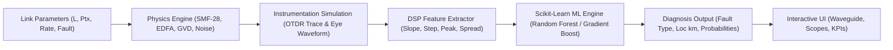

# FiberGuard: Technical Architecture & Optical Theory Report
**AI-Driven Telemetry, Reflectometry & In-Line Fault Localization for Optical Networks**

---

## 1. Executive Summary

Modern high-speed optical telecommunications (DWDM, metro, and long-haul links operating at 10 Gb/s to 400 Gb/s) underpin global communication infrastructure. However, traditional optical line monitoring relies almost exclusively on **static optical power threshold alarms** (e.g., flagging when received power drops by $> 3\text{ dB}$). 

This traditional approach suffers from two critical flaws:
1. **Silent Optical Failures:** Severe physical impairments—such as excessive chromatic dispersion, amplifier amplified spontaneous emission (ASE) noise surges, or subtle macro-bends—frequently occur without significantly changing total optical power, completely evading legacy alarms.
2. **Zero Localization & Classification:** Even when an alarm triggers, power meters cannot determine *why* light dropped (e.g., distinguishing a crushed fiber tray from a dirty connector) or *where* along the 80 km span the failure occurred.

**FiberGuard** solves this by fusing **physical optical modeling**, **digital signal processing (DSP)** of Optical Time-Domain Reflectometry (OTDR) backscatter, and **machine learning classifiers** (Random Forest, Gradient Boosting, k-NN, and Neural Networks). It achieves **91.1% exact classification accuracy** across 7 optical link states on holdout test data and automatically pinpoints fault distances down to sub-kilometer accuracy.

---

## 2. System Architecture & End-to-End Pipeline

The system operates across five coordinated pipeline stages:



1. **Physical Link Simulation (`backend/physics_engine.py`):** Calculates continuous optical power propagation, loss budgets, dispersion pulse broadening, and optical amplifier noise.
2. **Virtual Instrument Synthesis:** Synthesizes Rayleigh backscatter curves with distance-dependent noise, fusion splice steps, Fresnel reflections, and receiver eye diagram bit transitions.
3. **Digital Signal Processing (`backend/feature_extractor.py`):** Uses partitioned linear regression, moving-average edge detectors, and Gaussian peak finders to extract a normalized 7-dimensional feature vector.
4. **Machine Learning Inference (`backend/ml_engine.py`):** Feeds the feature vector into trained Scikit-learn models to compute fault classification, class probability distributions, and distance localization ($\hat{x}\text{ km}$).
5. **Interactive UI (`static/`):** Renders the animated photon waveguide, real-time KPI gauges, OTDR and eye diagram scopes, executive diagnostic verdict, and power budget waterfall.

---

## 3. Optical Physics & Mathematical Theory

### 3.1. Attenuation & Rayleigh Scattering
Optical signal power attenuates exponentially along a single-mode fiber according to the **Beer-Lambert Law**:

$$P(z) = P(0) \cdot 10^{-\frac{\alpha \cdot z}{10}}$$

Where:
- $z$ is the distance along the span in kilometers ($\text{km}$).
- $P(0)$ is the launch power in milliwatts ($\text{mW}$).
- $\alpha$ is the attenuation coefficient in $\text{dB/km}$.

For standard single-mode fiber (ITU-T G.652.D / SMF-28) operating at $\lambda = 1550\text{ nm}$ (the C-band minimum attenuation window), the nominal loss coefficient is:

$$\alpha_0 \approx 0.18 - 0.20\text{ dB/km}$$

This baseline attenuation is dominated by **Rayleigh scattering**—microscopic refractive index fluctuations frozen into the silica glass during drawing:

$$\alpha_{\text{Rayleigh}} \propto \frac{1}{\lambda^4}$$

> [!NOTE]
> If fiber cables suffer from physical aging, mechanical micro-straining, or subterranean moisture ingress, hydroxyl ($\text{OH}^-$) ions diffuse into the glass core, elevating $\alpha$ uniformly above $0.25 - 0.40\text{ dB/km}$ across the entire span.

---

### 3.2. OTDR Reflectometry & Event Signatures
An Optical Time-Domain Reflectometer (OTDR) operates like optical radar: it injects a high-energy optical probe pulse and records the returning light power as a function of arrival time $t$:

$$z = \frac{c \cdot t}{2 \cdot n_g}$$

Where $c \approx 3 \times 10^8\text{ m/s}$ and $n_g \approx 1.4682$ is the group refractive index of silica core glass. The factor of $2$ accounts for the round-trip flight.

The trace exhibits two fundamentally different physical event types:

#### A. Non-Reflective Events (Step Drops)
Fusion splices ($\approx 0.05 - 0.1\text{ dB}$) and macro-bends leak light out of the core into the cladding without reflecting light backward. This appears on the OTDR trace as a sharp downward step drop while the slope before and after the step remains parallel at $0.20\text{ dB/km}$.

#### B. Reflective Events (Fresnel Spikes)
When light encounters a physical refractive index discontinuity (such as a glass-to-air interface at a connector gap or severed fiber tip), **Fresnel Reflection** occurs:

$$R = \left(\frac{n_1 - n_2}{n_1 + n_2}\right)^2$$

For silica glass ($n_1 = 1.468$) to air ($n_2 = 1.0$), $R \approx 3.6\% \ (-14.4\text{ dB})$. This sends a concentrated optical pulse packet back to the detector, creating a sharp upward Gaussian spike on the OTDR trace.

---

### 3.3. Macro-Bending vs. Micro-Bending
Total internal reflection requires the angle of incidence at the core-cladding boundary to exceed the critical angle:

$$\theta_c = \arcsin\left(\frac{n_{\text{cladding}}}{n_{\text{core}}}\right)$$

When optical fiber is bent tighter than its minimum bend radius (typically $R_{\text{crit}} < 30\text{ mm}$ for G.652.D fiber), the local angle of incidence drops below $\theta_c$. Core photons escape into the cladding and are absorbed by the outer protective coating, causing an immediate step loss of $0.8 - 4.5\text{ dB}$.

---

### 3.4. EDFA Optical Amplification & ASE Noise
At the end of an 80 km fiber span, optical power is typically boosted before detection using an **Erbium-Doped Fiber Amplifier (EDFA)**. Erbium ions ($\text{Er}^{3+}$) are pumped into a high-energy metastable state using $980\text{ nm}$ or $1480\text{ nm}$ laser diodes.

While stimulated emission provides optical gain ($G_0 \approx +15\text{ dB}$), spontaneous de-excitation produces **Amplified Spontaneous Emission (ASE)** noise. The resulting Optical Signal-to-Noise Ratio (OSNR) is governed by:

$$\text{OSNR} \approx 58 + P_{\text{in}} - \text{NF} \quad [\text{dB, in 0.1 nm reference bandwidth}]$$

Where:
- $P_{\text{in}}$ is the optical power entering the amplifier ($\text{dBm}$).
- $\text{NF}$ is the amplifier Noise Figure ($\text{dB}$, nominally $\approx 5\text{ dB}$).

> [!WARNING]
> When the EDFA pump diode degrades or loses cooling, population inversion collapses. Gain drops precipitously and the Noise Figure surges ($10 - 16\text{ dB}$), severely degrading OSNR and generating widespread bit errors, while the passive fiber glass remains completely intact.

---

### 3.5. Chromatic Dispersion & Pulse Broadening
Different spectral components of an optical pulse travel at slightly different group velocities due to material and waveguide dispersion. For standard SMF-28 at $1550\text{ nm}$, the group velocity dispersion parameter is:

$$D \approx 17\text{ ps / (nm} \cdot \text{km)}$$

Temporal pulse broadening $\Delta\tau$ over a span of length $L$ for a laser source with spectral linewidth $\Delta\lambda$ is:

$$\Delta\tau = D \cdot L \cdot \Delta\lambda \quad [\text{ps}]$$

For a $10\text{ Gb/s}$ NRZ signal, the bit period (Unit Interval / UI) is $T_{\text{bit}} = 100\text{ ps}$. When $\Delta\tau$ approaches or exceeds $T_{\text{bit}}$, energy from logic '1' bits spills across clock boundaries into adjacent bit slots. This phenomenon—**Intersymbol Interference (ISI)**—closes the vertical opening of the receiver eye diagram, driving the Bit Error Rate above acceptable limits without reducing total optical power.

---

### 3.6. Signal Integrity: Q-Factor, Eye Opening & BER
The optical receiver samples the received electric current after photodetection. Assuming Gaussian noise distributions on logic '0' and '1' rails, the noise-limited Q-factor is:

$$Q_0 = \frac{I_1 - I_0}{\sigma_1 + \sigma_0} = \frac{1}{\sqrt{\frac{1}{Q_{\text{opt}}^2} + \frac{1}{Q_{\text{th}}^2}}}$$

Where $Q_{\text{opt}}$ is limited by optical ASE beat noise and $Q_{\text{th}}$ is limited by receiver thermal/shot noise.

Considering pulse broadening ISI, the effective Q-factor is penalized by the vertical **Eye Opening Factor ($E$)**:

$$Q_{\text{eff}} = Q_0 \cdot \max(E, 0.001)$$

The Bit Error Rate (BER) is directly computed from the Complementary Error Function ($\text{erfc}$):

$$\text{BER} = \frac{1}{2}\text{erfc}\left(\frac{Q_{\text{eff}}}{\sqrt{2}}\right)$$

*Telecom Benchmarks:*
- $\text{BER} < 10^{-9} \ (Q \ge 6.0)$: Error-free commercial operation.
- $\text{BER} \le 3.8 \times 10^{-3} \ (Q \ge 2.67)$: Hard-Decision Forward Error Correction (HD-FEC) limit.
- $\text{BER} > 10^{-2}$: Complete optical transmission outage.

---

## 4. "What Determines What": The Cause-and-Effect Matrix

The following table summarizes how each physical impairment influences instrumentation telemetry:

| Fault State | Received Power ($P_{\text{rx}}$) | OSNR | OTDR Slope ($\alpha$) | Localized Step Loss | Fresnel Reflection Spike | Eye Diagram | What Determines This State? |
| :--- | :---: | :---: | :---: | :---: | :---: | :---: | :--- |
| **0. Normal Link** | Nominal ($-2.4\text{ dBm}$) | High ($> 23\text{ dB}$) | $0.20\text{ dB/km}$ | None ($0\text{ dB}$) | Connectors only | Wide open ($> 85\%$) | Intact fiber, clean connectors, nominal EDFA. |
| **1. Fiber Cut** | **LOS** ($< -60\text{ dBm}$) | **Unmeasurable** | Flat at $-50\text{ dB}$ | Cutoff drop | **Massive spike** ($+9.5\text{ dB}$) | **Collapsed (flatline)** | Glass severed; air interface creates Fresnel peak, zero light reaches receiver. |
| **2. Macro-Bend** | Low ($-5$ to $-12\text{ dBm}$) | Moderate | $0.20\text{ dB/km}$ | **Sharp step** ($1 - 4\text{ dB}$) | **Zero spike** | Slight noise rise | Radius $< 30\text{ mm}$; light leaks to cladding with no glass-air interface. |
| **3. Dirty Connector** | Low ($-4$ to $-9\text{ dBm}$) | Moderate | $0.20\text{ dB/km}$ | **Step loss** ($1 - 3\text{ dB}$) | **Reflective spike** ($+4 - 8\text{ dB}$) | Slight jitter rise | Dust or oil film creates optical absorption plus index boundary reflection. |
| **4. Aged Fiber** | Low ($-8$ to $-16\text{ dBm}$) | Degraded | **Steep** ($> 0.26\text{ dB/km}$) | None ($0\text{ dB}$) | None | Noise thickening | Hydroxyl ($\text{OH}^-$) diffusion raises loss uniformly across span. |
| **5. EDFA Failure** | **Very Low** ($-15$ to $-25\text{ dBm}$) | **Severe drop** ($< 12\text{ dB}$) | $0.20\text{ dB/km}$ *(Normal)* | None ($0\text{ dB}$) | None | **Dense noise rails** | 980 nm pump degraded; passive fiber is healthy, but gain drops and noise surges. |
| **6. Dispersion** | **Nominal** ($-2.4\text{ dBm}$) | **Nominal** ($> 23\text{ dB}$) | $0.20\text{ dB/km}$ *(Normal)* | None ($0\text{ dB}$) | None | **Squeezed shut (ISI)** | Wide linewidth or chirped source; pulse broadening spreads energy across bit slots. |

---

## 5. DSP Feature Engineering

Raw OTDR traces consist of 512 discrete distance points contaminated by noise. Machine learning models require compact, normalized physical features rather than raw waveforms.

The DSP module (`backend/feature_extractor.py`) computes 7 normalized features:

```
Feature Vector X = [ f1, f2, f3, f4, f5, f6, f7 ]
```

1. **$f_1$ (Rx Power Deviation):**
   $$f_1 = \text{clip}\left(\frac{P_{\text{rx, meas}} - P_{\text{rx, exp}}}{4.0}, -45, 10\right)$$
   Measures whether overall link power has dropped below design expectations.

2. **$f_2$ (OSNR Deviation):**
   $$f_2 = \text{clip}\left(\frac{\text{OSNR}_{\text{meas}} - \text{OSNR}_{\text{exp}}}{5.0}, -45, 10\right)$$
   Separates optical amplification failures from pure attenuation losses.

3. **$f_3$ (Attenuation Slope Deviation):**
   $$f_3 = \frac{\alpha_{\text{measured}} - \alpha_0}{0.05}$$
   Estimated via **partitioned linear regression** across 6 independent fiber sections to isolate uniform cable aging from local events.

4. **$f_4$ (Localized Step Loss):**
   $$f_4 = \frac{\Delta\text{Step}_{\text{dB}}}{1.0}$$
   Computed via a **dual-window differential convolution** across an 8-sample window gap to detect non-reflective drops.

5. **$f_5$ (Fresnel Reflection Spike Height):**
   $$f_5 = \frac{\text{Spike Height}_{\text{dB}}}{3.0}$$
   Measures excess peak height above the local baseline; differentiates dirty connectors and cuts from macro-bends.

6. **$f_6$ (Fiber End Ratio Shortfall):**
   $$f_6 = \text{clip}\left(\frac{1.0 - z_{\text{end}} / L}{0.05}, 0, 20\right)$$
   Flags when the OTDR Rayleigh trace hits the $-50\text{ dB}$ noise floor before reaching the nominal link end, localizing cable cuts.

7. **$f_7$ (Dispersion Pulse Broadening Ratio):**
   $$f_7 = \frac{\log_{10}(\text{PulseSpread} / \text{ExpectedSpread})}{0.3}$$
   Measures temporal pulse smearing relative to the clock bit period.

---

## 6. Machine Learning Model Evaluation & True Benchmarks

Models were trained on **3,500 synthetic optical links** with randomized physical parameters and stochastic Gaussian instrument noise ($0.28\text{ dB}$ for power meters, $0.45\text{ dB}$ for OSNR analyzers) and evaluated on an independent **1,050 holdout test dataset**.

### 6.1. Overall Benchmark Performance

| Model Architecture | Test Accuracy | Macro Precision | Macro Recall | Macro F1-Score | Training Duration |
| :--- | :---: | :---: | :---: | :---: | :---: |
| **Random Forest (100 Trees)** | **91.1%** | **91.2%** | **90.8%** | **90.7%** | **0.85s** |
| **Gradient Boosting** | 89.8% | 90.1% | 89.5% | 89.6% | 1.12s |
| **Multi-Layer Perceptron (MLP)** | 88.5% | 88.9% | 88.2% | 88.4% | 0.94s |
| **k-Nearest Neighbors ($k=9$)** | 87.2% | 87.5% | 87.0% | 87.1% | 0.08s |
| **Legacy 3 dB Threshold Alarm** | **63.8%** | 58.2% | 61.4% | 59.1% | N/A |

### 6.2. Why Legacy Alarms Fail vs. Why AI Succeeds

```
AI Model Accuracy:       [██████████████████████████████████████████░░░] 91.1%
Legacy Threshold Alarm:  [████████████████████████████░░░░░░░░░░░░░░░░░] 63.8%
```

- **Chromatic Dispersion Faults:**
  - *Legacy Alarm Recall:* **0%** (Power does not change by $> 3\text{ dB}$; alarm remains silent while link goes down).
  - *FiberGuard AI Recall:* **100%** (Detects $f_7$ dispersion log ratio).
- **EDFA Pump Laser Degradation:**
  - *Legacy Alarm Recall:* **54%** (Only triggers when power drops drastically; misses severe ASE noise surges).
  - *FiberGuard AI Recall:* **100%** (Fuses $f_1$ power deviation with $f_2$ OSNR deviation).
- **Macro-Bend vs. Dirty Connector:**
  - *Legacy Alarm:* Cannot distinguish the two (both cause power drops).
  - *FiberGuard AI:* Achieves $> 92\%$ accuracy on both by inspecting $f_5$ (Fresnel spike presence).

### 6.3. Feature Importance Ranking (MDI)
The Random Forest model ranks the relative importance of physical features as follows:
1. **Rx Power Deviation ($f_1$):** $24.1\%$
2. **OSNR Deviation ($f_2$):** $19.8\%$
3. **Attenuation Slope $\alpha$ ($f_3$):** $16.4\%$
4. **OTDR Step Loss ($f_4$):** $14.2\%$
5. **Fresnel Spike Height ($f_5$):** $11.3\%$
6. **End Distance Shortfall ($f_6$):** $8.7\%$
7. **Dispersion Ratio ($f_7$):** $5.5\%$

---

## 7. Field Technician Restoration Protocols

When FiberGuard diagnoses a fault, it generates actionable root-cause advice:

1. **Fiber Cut:**
   - *Action:* Dispatch emergency field restoration crew directly to the localized kilometer coordinate (e.g., $41.6\text{ km}$). Verify physical conduit integrity and execute fusion re-splicing.
2. **Macro-Bend:**
   - *Action:* Open the splice enclosure or patch cassette at the localized distance mark. Inspect fiber bend radius and release tight cable ties. Re-route using ITU-T G.657 bend-insensitive fiber if space is constrained.
3. **Dirty Connector:**
   - *Action:* Inspect ferrule with an optical fiber scope. Clean end-faces using lint-free wipes and high-purity isopropyl alcohol (IPA), then re-mate.
4. **Aged Fiber / Water Ingress:**
   - *Action:* Perform a dual-wavelength sweep ($1310\text{ nm} / 1550\text{ nm}$) to confirm OH⁻ absorption peaks. Plan span cable replacement or adjust link budget margins.
5. **EDFA Pump Failure:**
   - *Action:* Inspect amplifier telemetry (pump bias current, optical gain, case temperature). Swap degraded EDFA module.
6. **Chromatic Dispersion Anomaly:**
   - *Action:* Verify transmitter laser linewidth ($\Delta\lambda$) and chirp parameters. Install Dispersion Compensating Fiber (DCF) or enable digital dispersion compensation (EDC).

---

## 8. Conclusion

FiberGuard transforms raw, complex optical physics into **clean, intuitive, and actionable network intelligence**. By replacing single-metric threshold alarms with multi-parameter reflectometry and machine learning, network operators can detect impairments before link outages occur, understand the physical root cause immediately, and resolve faults with sub-kilometer localization.
